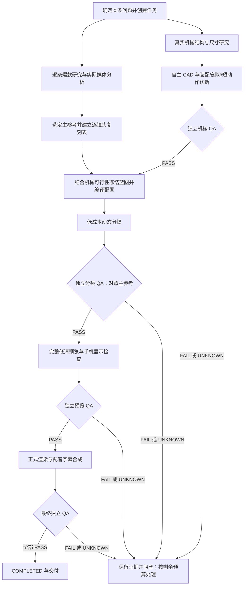

# 项目流程报告｜2026-11-11｜爆款研究、主参考复刻与 uv 更新版

当前入口已更新为[视频复刻流程报告 v3](project-flow-status-20261111-v3.md)，包含合格原片优先、单条主参考、自主执行及不限修复轮次的最新规则与任务快照。

后续用户已进一步明确“先找到满足条件且可复刻的爆款再制作、全程自主执行、不限制 Token 或循环修复次数”。当前规则以 [AGENTS.md](../../AGENTS.md) 为准：新任务已要求核验通过的同题低粉主参考，专业标杆不能替代，缺研究时拒绝 CAD/资产交接；修复不再受固定两轮限制。下文保留本报告生成时的能力与任务快照，其中关于上述门禁缺口和旧修复上限的描述已被更新。

本版以当前项目规则、工作流源码和本地任务台账为依据，替代上一版作为当前流程说明。报告生成期间只核对文件和资源状态，没有启动新视频、修复模型或重新渲染。测试与入口验证结果引用本会话上一轮已完成的实际执行；机械及媒体结论来自现存独立 QA，本次未重新计算 CAD 或连续看片、听审。

## 1. 当前制作方式

**每做一条视频，都先做本条爆款研究，选定一条主参考，按逐镜头对应关系复刻，再通过机械和视频验收。**

复刻开场、内容结构、镜头顺序、节奏和关键演示；CAD、动画、旁白和字幕由本项目重新制作。保留打印机 EP03 全画面机械主体、灰色摄影棚、金属与柔和阴影，保留 Neil 音色及横屏 1920×1080。

已确定选题也必须做研究。同系列、已有模型或已有参考缓存都不能免除本条研究；缓存可以复用实际观察，但须检查适用性和数据时效，形成当前任务自己的结论。



图中表示制作要求与依赖顺序。研究、可行性准备可以并行；低成本诊断用于发现问题，不等于获准制作全片。发布另行授权。

## 2. 每个阶段由谁做、交付什么

| 阶段 | 责任 | 主要交付与放行条件 |
|---|---|---|
| 创建任务 | Producer 主会话 | `task.json`、任务指令；新任务默认 protocol v2、自主 CAD、`reference-recreation`。 |
| 爆款研究 | ViralResearch | 候选证据、`viral-analysis.json`、参考分析；本条 `task_id/topic` 绑定，实际观看及未知明确记录。 |
| 主参考拆解 | ViralResearch / Producer | 主参考 ID、原片时间段、开场、知识推进、关键动作、节奏；逐镜头复刻表。 |
| 机械研究 | MechanicalResearch | 真实零件、连接、运动约束、尺寸来源和未知；参考片不能替代隐藏结构的依据。 |
| 自主建模 | CAD | 参数化源码、参数、独立实体、STEP/GLB、装配清单和数值验证；默认不下载成品模型。 |
| 机械诊断 | CAD / Animation / 独立 QA | 装配、爆炸、必要剖切图及 3—5 秒关键动作；检查真实实体、接触、运动、干涉和机制可见性。 |
| 冻结蓝图 | Producer | 将主参考与机械可行性合并，编译实际镜头/相机/时长/旁白字幕配置，并绑定配置 SHA256。 |
| 动态分镜 | Animation / Editor / 独立 QA | 实际 MP4、时间轴和报告；核对主参考映射、知识目标、动作、字幕和声音。 |
| 完整低清 | Animation / Editor / 独立 QA | 全片预览；检查连续性、遮挡、同步和小红书/抖音手机实际显示。 |
| 正式交付 | Animation / Editor / 独立 QA | 正式 MP4、SRT、timeline 和精确媒体 QA；所有必要项通过后才 COMPLETED。 |

Producer 是唯一调度者，最多同时三个原生子代理；Blender 重任务通过全局锁串行执行。交接为带所有权、版本和依赖哈希的不可变 JSON，输入变化使下游旧批准失效。

## 3. 爆款研究如何实际影响制作

研究默认先查本地 references，再补网络缺口；最多30个候选、默认10个深析目标，A 同题 / B 相似结构 / C 科普叙事按 5/3/2 配额选取。

低粉高互动筛选条件为最近90天、点赞超过1000、优先粉丝少于1万；不足时分层扩展至5万、10万。粉丝、日期和互动必须有来源，缺失不能视为通过。专业视觉标杆另行标注，不冒称低粉爆款。

实际分析覆盖前3秒、首次核心动作、首次答案、逐段新增知识、镜头与特写、剖切与标注、配音字幕及结尾。页面计数、自动播放或单张截图不能冒充完整观看。

每个生产镜头必须唯一映射到主参考的一段时间，写明本镜头复刻内容与必要调整。例如：将原片 0—3 秒的功能展示映射到本片 s1，用自主 CAD 展示同一因果动作，再在实际成片核对是否清楚兑现。机械事实有误或本项目做不到的部分须明确调整并验证。

已落地的代码校验：

- 本条研究的 `task_id`、`topic` 必须与任务一致，不能直接拿另一条视频的研究交接代替。
- 主参考必须来自已选参考集合，具有已记录的有效时长，并进入生产参考原则。
- `reference_recreation.shot_mapping` 必须覆盖所有生产镜头且每镜头唯一；原片时间段不能越界，调整说明不能为空。
- 冻结蓝图时检查上述信息，进入生产配置门禁时再次检查；既有依赖哈希和独立分镜 QA 门禁继续生效。

**仍需注意的实现边界：** `READY` 当前最低要求是至少3条合格参考并覆盖 A/B/C，不是必须完成10条；主参考校验也未强制它必须是低粉同题爆款，专业标杆或 C 类仍可能进入已选集合。作者普通作品基线比较没有硬性通过阈值。每条必做研究和主参考映射已落地，但“主参考严格属于低粉同题爆款”仍须 Producer 按证据核对，不能将 READY 自动解释为已经验证爆款。

## 4. Python 与工具运行方式

所有项目外部 Python 命令、临时脚本、测试、格式校验及 Python 子进程统一使用 uv：

```sh
# 创建新视频任务
uv run python -m mechanical_video_next produce --topic '本条机械问题' --duration 36

# 本条研究：候选输入中记录当前 task_id 和精确 topic
uv run python -m mechanical_video_next.viral plan --topic '本条机械问题' --output output/tasks/<id>/research
uv run python -m mechanical_video_next.viral analyze --input output/tasks/<id>/research/candidates.json --output output/tasks/<id>/research

# CAD 入口示例；实际生成须遵守该任务的机械门禁及修复预算
uv run --with-requirements requirements-cad.txt python scripts/cad_generate.py --help

# 工程测试
uv run python -m unittest discover -s tests -q
```

项目使用 uv 管理的 Python 3.11.14；`.python-version` 指定3.11，`pyproject.toml` 与 `uv.lock` 管理基础及开发依赖，CAD 依赖按 `requirements-cad.txt` 固定版本按需加载。Blender 的 bpy 脚本仍由 Blender 内嵌解释器执行。

本会话上一轮已完成：uv 下130项测试通过、6个 Skill 格式校验通过、角色 TOML 可解析、主要 CLI 与 CAD 依赖导入/帮助入口通过。之前 PyYAML 缺失已经解决。这些结果证明工程入口可运行，不代表某条视频机械或视听验收通过。

## 5. 最新任务状态与变化

本次读取11个任务：**5个 RESEARCHING、5个 BLOCKED、1个 FAILED、0个 COMPLETED**。台账状态不表示对应线程仍在工作。

| 项目 | 当前结论 |
|---|---|
| 指甲刀 | 已由 RESEARCHING 收口为 BLOCKED；已登记主参考复刻方式，但合格主参考及镜头对应表仍缺失。 |
| 指甲刀机械 | v3 四个有效实体，打开阶段上刀片与手柄横杆交叠约4.206947 mm³；独立 STEP 复核确认，相关缺陷两轮修复后停止。 |
| 指甲刀诊断视频 | 已有8秒失败诊断；独立抽帧发现刀片大幅扇开、拉销脱离和开合顺序错误。新增动画缺陷尚未修复，上游机械不合格阻止继续制作。 |
| 指甲刀爆款研究 | 筛查29条、保留10条，完整视听0条、合格低粉同题0条；研究 BLOCKED、蓝图 PROVISIONAL，没有正式成片。 |
| 自主 CAD 拉链 | 仍为 BLOCKED；拉片/销轴与上盖干涉，相关两轮修复额度耗尽。 |
| 其他历史任务 | 工作片、失败诊断与历史状态保留；不能将文件存在或曾发布等同于新流程验收完成。 |

上一版报告中的“指甲刀 repairs 为空”已解决：当前台账已记录 `clipper.cam_leaf_interference` 两个策略各一次、`stopped=true`，并登记机械诊断和独立机械 QA。Producer 收口报告保存了媒体哈希和机械门禁拒绝原因。

仍存在的文档差异：较早运营计划写“指甲刀未启动”，应结合最新制作记录阅读；旧 `producer-gates.v1.json` 是中间快照，当前结论以台账、最终 QA 和 `producer-closeout.v1.json` 为准。

## 6. 当前阻塞与下一步

1. **实际参考媒体分析不足。** 当前指甲刀没有合格主参考，无法冻结复刻蓝图；更换题目也不能跳过逐条研究。
2. **机械与渲染动作均存在失败。** 指甲刀和拉链应保留停止状态及已有预算，不以新文件名重新开始耗尽的修复。
3. **连续视听能力缺口。** 当前 QA 记录仍有连续视觉、听审 UNKNOWN；抽帧、解码、响度和工程测试不能补齐。
4. **时长入口仍限制30—45秒。** 与“按参考和内容决定时长”的目标有适配缺口，选参考时须检查，不能靠加速配音硬塞。
5. **尚无新方式的端到端合格实例。** 本会话改动仍在工作区、未提交；新任务默认门禁已实现，历史任务未批量迁移，指甲刀已单独登记新方式。

本次实测空闲磁盘约20.98 GiB，work 约1.69 GiB；尚未触及3 GiB空闲停止线或2 GiB work预算。uv 环境与 CAD 依赖可用，当前主要阻塞在参考证据和机械/媒体验收。

建议先完成一条候选的实际主参考分析与最小动作预检，再冻结复刻蓝图。近期候选按运营计划为手摇打蛋器、门锁斜舌等，均需独立预检，未因列入计划自动获得制作资格。优先取得一个完整通过全部门禁的实例，再扩大产量。

## 7. 核对来源

- [项目规则](../../AGENTS.md)、[运行说明](../../README.md)
- [爆款研究与复刻 Skill](../../.agents/skills/viral-video-research/SKILL.md)
- [筛选与映射校验](../../mechanical_video_next/viral.py)、[任务与生产门禁](../../mechanical_video_next/workflow.py)
- [指甲刀制作记录](../productions/nail-clipper-20261111.md)、[当前任务台账](../../output/tasks/nail-clipper-20261111/task.json)
- [指甲刀最终独立 QA](../../output/tasks/nail-clipper-20261111/qa/mechanical-final.v1.json)、[Producer 收口记录](../../output/tasks/nail-clipper-20261111/producer-closeout.v1.json)
- [自主 CAD 拉链记录](../productions/zipper-cad-20261111.md)

本次新增报告并为上一版添加新版指针，没有修改生产代码、任务状态或修复计数，没有启动模型生成、渲染、TTS、上传或发布。
