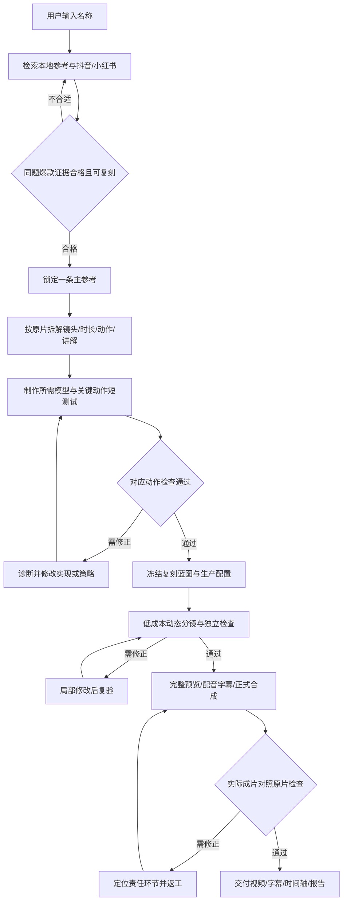

# 视频复刻流程报告｜2026-11-11｜当前版

核对时间：2026-11-11 22:05（北京时间）。依据当前项目规则、源码及本地任务台账。本版覆盖此前报告中的多参考必选、先建模后找参考和固定修复轮次描述；旧文件保留历史证据。本次仅生成报告，没有启动新视频、建模、渲染或发布。

## 1. 用户输入与系统目标

用户提供机械名称，例如“指甲刀”。Producer 负责寻找合格爆款、选择主参考、拆解镜头、复刻制作、检查、返工和交付，中间不要求用户逐步确认方案。

**原片是制作规格。** 按原片展示的内容、镜头顺序、节奏、动作与讲解复现；模型和动画服务于这些镜头。不擅自增加原片未展示的隐藏结构、机构创新或工业级制造验证目标。

当前保留已选打印机 EP03 视觉、Neil 音色和横屏1920×1080。复刻原片的组织和表达，使用本项目自己的模型、动画和配音制作。

## 2. 完整执行流程

图中的返工按实际缺陷回到对应上游；模型或镜头变更会使相关旧验收失效，需要重新检查。流程目标是自主完成，工程命令成功本身不代表成片通过。

| 步骤 | 系统执行内容 | 阶段产物 |
|---|---|---|
| 1. 创建任务 | 记录名称、既有风格、配音和自主执行规则 | 本条任务台账 |
| 2. 找合格爆款 | 检索、核验公开数据、分析实际视频、评估复刻路径；候选不合适就继续搜索 | 原片链接、指标证据、观察记录 |
| 3. 锁定主参考 | 选一条符合条件的同题原片；其他资料仅补充 | 已核验主参考 ID |
| 4. 拆解复刻规格 | 记录每个镜头的原片起止时间、画面、动作、讲解、节奏及必要调整 | 逐镜头对应表、脚本与蓝图 |
| 5. 复刻资产和动作 | 为原片展示内容生成所需模型；先验证关键动作，再做全片 | CAD/GLB、关键帧、短动作预览 |
| 6. 分镜与完整制作 | 编译镜头配置，先低成本分镜及预览，再完成动画、Neil 配音、字幕和合成 | 分镜片、预览、正式 MP4 |
| 7. 检查与返工 | 对照主参考逐项检查；不通过由 Producer 分派修复并独立复验 | 版本化缺陷、修复与验收记录 |
| 8. 交付 | 汇总精确文件与验收结果 | MP4、SRT、timeline、来源及检查报告 |

## 3. 爆款从哪里找、如何选

主要来源是**抖音、小红书**，先查本地参考缓存，再搜索缺口。YouTube、B站目前未设为默认主搜索渠道。

当前筛选条件：

- 与输入名称直接相关，能作为本条的实际复刻对象。
- 最近90天发布，点赞超过1000。
- 优先粉丝少于1万；不足时分层扩展到5万、10万，并保留真实观察值。
- 有原始链接、日期、公开指标及实际完整观看证据；未知值不能冒充符合条件。
- Producer 在制作前评估原片所需模型、动作、镜头和工具是否有可实现路径。

**一条合格主参考就够。** A同题、B相似结构、C科普叙事的分类仍可帮助组织资料，但B/C、多风格和10条深析不是进入复刻的必选条件。专业标杆可以辅助，不能替代同题低粉主参考。

30候选/10深析是单批处理规模，不是整个任务的停止次数。未找到合格主参考时，Producer 自主换查询或批次继续；不把未合格候选交给用户决定，也不先建模再补参考。

## 4. 谁来执行、用户参与什么

Producer 是唯一主调度，使用真实原生子代理：ViralResearch 负责选片和拆解，MechanicalResearch 核对复刻所需事实，CAD/Animation/Editor 负责制作，独立 QA 负责检查。最多同时三个子代理，Blender 重任务串行。

常规选参考、镜头调整、建模、修改代码、运行测试、返工和继续执行由 Producer 负责，不逐步问用户。用户只需给名称和主动提出的偏好；发布不包含在制作授权内。

不设用户层面的 Token、总修复轮数或策略数量上限。无改善时诊断并更换实现/策略，保留同一问题的历史；不反复执行未改变的失败方案，也不因到了第三轮就结束任务。

旧任务接续时用 `adopt-autonomy` 记录当前政策；旧失败、次数和停止事实继续保留。政策更新不会自动启动全部历史任务，也不会把旧失败改成通过。

## 5. 已落实的代码门禁

| 项目 | 当前实现 |
|---|---|
| 新任务默认方式 | `reference-recreation`，`reference_first=true`，`repair_mode=until_pass`。 |
| 严格主参考 | READY 必须具有核验通过的同题低粉高互动主参考；单条合格主参考可通过，专业标杆不能替代。 |
| 研究属于本条 | 检查 `task_id/topic`，防止直接套用另一条视频的研究交接。 |
| 先研究后 CAD | 新政策任务缺合格研究时，拒绝 `cad-model` / `asset-plan` 交接。Agent 指令也要求建模前选好主参考。 |
| 按原片逐镜头对应 | 主参考必须与已核验 ID 一致；每个生产镜头唯一映射原片时间段，时间不能越界，调整说明不能为空。 |
| 修复无固定轮次 | 新任务可超过旧两轮及两策略限制；无改善记录换策略动作，仍处于修复流程。 |
| 版本与验收一致 | 配置、交接和媒体绑定哈希，修改后旧批准失效；修复次数或低缺陷数值不会自动授予最终通过。 |
| Python 统一入口 | 命令、临时脚本、测试与 Python 子进程通过 `uv run`；Blender 内嵌 Python 由 Blender 执行。 |

代码门禁检查的是提交到工作流的证据和字段；实际观看、复刻可行性及制作选择仍由具备相应能力的代理执行。`produce` 默认创建任务并交给当前 Producer，并非一个已经验证能独立生成任意题材的视频服务。

项目使用 uv 管理的 Python 3.11，基础依赖有 `uv.lock`；CAD 依赖通过 `requirements-cad.txt` 按需加载。最近一轮本会话回归为 **133项测试通过**，uv/CAD 入口已验证；此前6个 Skill 格式和角色 TOML 检查通过。本次报告未重复运行测试或制作媒体。

## 6. 当前实际进度

22:05附近的本地快照有 **13个任务：6个 RESEARCHING、6个 BLOCKED、1个 FAILED、0个 COMPLETED**。其他会话可能继续更新，状态不代表线程活跃数量。

| 任务 | 当前记录 |
|---|---|
| `nail-clipper-fresh-20261111` | RESEARCHING；已带完整新自主政策及主参考优先设置；尚无正式研究交接、制作阶段为0。 |
| `nail-clipper-remake-20261111` | RESEARCHING；制作记录已转为先找主参考，尚无正式研究交接、制作阶段为0；台账尚未登记新 autonomy_policy。 |
| `nail-clipper-20261111` | 旧失败任务 BLOCKED，保留诊断与缺陷；制作记录显示已退出新重制输入。 |
| 拉链及其他历史任务 | 各自保留研究、失败或工作片状态；不能据此推断新复刻流程已交付完成。 |

指甲刀重制记录中已有同题高互动候选，但记录尚未证明它们满足当前全部条件：有超过90天的历史作品，也有日期或完整观看证据未完成的作品。它们仍是候选，不能写成已锁定合格主参考。按当前流程应继续核验和搜索，不据候选提前启动生产。

空闲磁盘约20.29 GiB，work约1.69 GiB；当前未触及3 GiB空闲停止线或2 GiB工作缓存预算。

## 7. 当前结论与执行边界

流程已经改成**合格原片优先、逐镜头复刻、Producer 自主执行与持续返工**。过去“没有合格主参考先做模型”的顺序不再作为新任务流程。

目前尚无一条按全部新规则走完、独立验收完成的端到端实例。下一条的实际验收应证明：从名称输入开始，系统完成选片、复刻、返工和交付，过程没有要求用户作常规制作决策。不能用133项工程测试代替这次真实交付。

仍需按执行时实际情况处理的范围包括：当前 CLI 时长入口仍为30—45秒；按原片需要调整时，应由 Producer 处理实现，不靠加速旁白凑时长。复刻范围的新规则已经记录，但工作流还保留通用机械和媒体 QA 必填项，应按实际原片内容解释检查范围，不另增隐藏结构研发任务。此前关于“不考虑视听”的讨论没有自动关闭最终验收项，未执行的检查仍如实标注。

## 8. 依据与入口

- [当前项目规则](../../AGENTS.md)、[运行说明](../../README.md)
- [爆款研究 Skill](../../.agents/skills/viral-video-research/SKILL.md)
- [参考筛选与复刻映射代码](../../mechanical_video_next/viral.py)、[任务与修复门禁](../../mechanical_video_next/workflow.py)
- [指甲刀 fresh 台账](../../output/tasks/nail-clipper-fresh-20261111/task.json)、[指甲刀重制记录](../productions/nail-clipper-remake-20261111.md)
- [旧指甲刀失败记录](../productions/nail-clipper-20261111.md)

本次仅新增报告并更新报告入口；没有更改任务状态、修复计数、生产代码或媒体。
